# 🗺️ CONCEPT OF PROJECT — Mini E-Wallet & Distributed Transfer System

Dokumen ini adalah **gambaran visual** sistem yang sedang kita bangun: fitur apa saja, bagaimana alurnya, dan apa peran setiap teknologi di dalam alur tersebut.

- **PRD** ([ProductRequirementDocument.md](ProductRequirementDocument.md)) → *apa* yang harus dibangun.
- **Concept of Project** (dokumen ini) → *bagaimana bentuk* sistemnya secara utuh.
- **Guidebook** ([GUIDEBOOK.md](GUIDEBOOK.md)) → *rekam jejak* apa yang sudah dibuat.

> Cara melihat diagram: buka file ini di GitHub, atau di VS Code tekan `Ctrl+Shift+V` (Markdown Preview). Diagram ditulis dengan **Mermaid**.

**Legenda status:** ✅ Sudah dibuat · 🟡 Sebagian · ⏳ Rencana

---

## 📑 Daftar Isi
1. [Peta Fitur & Status](#1-peta-fitur--status)
2. [Arsitektur Keseluruhan](#2-arsitektur-keseluruhan)
3. [Peran Setiap Tech Stack](#3-peran-setiap-tech-stack)
4. [Struktur Dalam Satu Service (Clean Architecture)](#4-struktur-dalam-satu-service-clean-architecture)
5. [Alur Fitur](#5-alur-fitur)
6. [Model Data](#6-model-data)
7. [Kunci Redis & Event Kafka](#7-kunci-redis--event-kafka)
8. [Skenario Gagal & Jaminan Sistem](#8-skenario-gagal--jaminan-sistem)
9. [Roadmap Pengerjaan](#9-roadmap-pengerjaan)
10. [Keputusan Desain yang Masih Terbuka](#10-keputusan-desain-yang-masih-terbuka)

---

## 1. Peta Fitur & Status

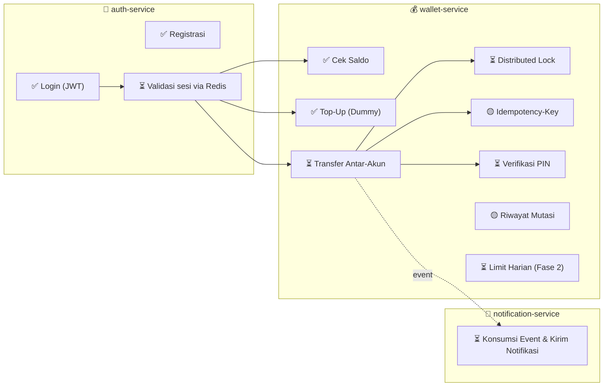

| Fitur | Service | Endpoint | Prioritas PRD | Status |
|---|---|---|---|---|
| Registrasi | auth | `POST /api/v1/auth/register` | Must | ✅ |
| Login (JWT) | auth | `POST /api/v1/auth/login` | Must | ✅ |
| Validasi sesi JWT via Redis | wallet (middleware) | — | Must | ⏳ (R11) |
| Cek Saldo | wallet | `GET /api/v1/wallets/balance` | Must | ✅ |
| Top-Up Dummy | wallet | `POST /api/v1/wallets/topup` | Must | ✅ |
| Transfer Antar-Akun | wallet | `POST /api/v1/transfers` | Must | ⏳ Modul 3 |
| Distributed Lock Anti-Spam | wallet + Redis | — | Must | ⏳ Modul 3 |
| Idempotency-Key | wallet | Header `Idempotency-Key` | Must | 🟡 kolom unik ada, header belum dibaca (R8) |
| Verifikasi PIN | wallet / auth | — | Must | ⏳ |
| Asynchronous Notification | wallet → Kafka → notification | — | Must | ⏳ Modul 4 |
| Riwayat Mutasi (Ledger) | wallet | `GET /api/v1/wallets/transactions` *(usulan)* | Should | 🟡 repository ada (bug R5), endpoint belum |
| Limit Transaksi Harian | wallet | — | Nice | ⏳ Fase 2 |

---

## 2. Arsitektur Keseluruhan

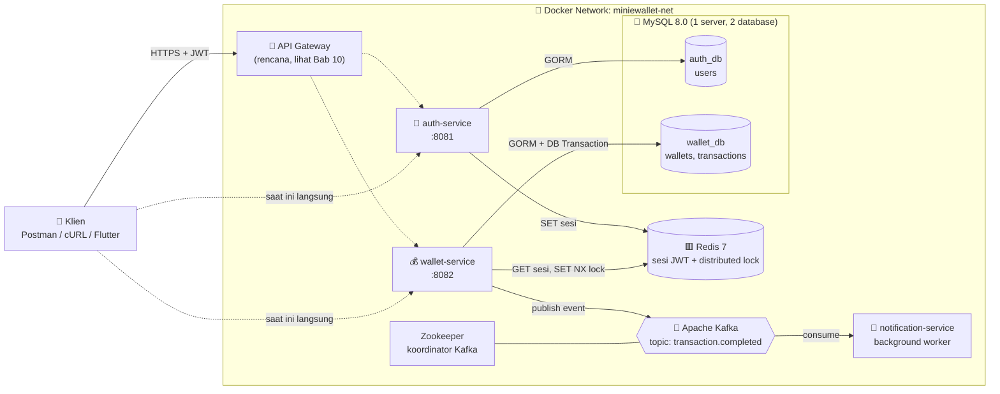

**Prinsip arsitektur yang dipakai:**
- **Database-per-Service:** `auth-service` hanya menyentuh `auth_db`, `wallet-service` hanya menyentuh `wallet_db`. Tidak ada service yang membaca database milik service lain. Komunikasi antar-service lewat **JWT** (data identitas dibawa token) dan **event Kafka**.
- **Synchronous untuk uang, Asynchronous untuk notifikasi:** pemindahan saldo harus selesai dan pasti sebelum API membalas. Notifikasi boleh menyusul di latar belakang sehingga tidak memperlambat API.
- **Stateless service:** service Go tidak menyimpan state di memori. Sesi ada di Redis, data di MySQL, sehingga service bisa dijalankan lebih dari satu instance.

---

## 3. Peran Setiap Tech Stack

| Stack | Dipakai oleh | Kegunaan dalam alur | Fitur terkait |
|---|---|---|---|
| **Golang** | Semua service | Bahasa utama. Goroutine membuat server mampu melayani banyak request bersamaan. | Semua |
| **Chi v5** | auth, wallet | Router HTTP: mendaftarkan endpoint, middleware (`Logger`, `Recoverer`, `RequireAuth`), grup rute. | Semua endpoint |
| **JWT v5** | auth (membuat), wallet (memverifikasi) | "Tiket masuk" berisi `user_id` + masa berlaku, ditandatangani HS256. Wallet tidak perlu bertanya ke auth untuk tahu siapa user-nya. | Login, Auth Guard |
| **Bcrypt** | auth | Hash password satu arah (cost 10). Kelak juga untuk hash PIN. | Registrasi, Login, PIN |
| **MySQL 8.0** | auth, wallet | Penyimpanan permanen. Fitur **transaction** (`BEGIN/COMMIT/ROLLBACK`) dan **row lock** (`SELECT ... FOR UPDATE`) menjamin saldo selalu benar. | Semua data, ACID |
| **GORM v2** | auth, wallet | ORM: AutoMigrate tabel, query, `db.Transaction(...)` yang otomatis commit/rollback. | Semua akses DB |
| **Redis 7** | auth, wallet | (1) **Sesi JWT** — token aktif disimpan agar bisa dicabut (logout). (2) **Distributed lock** — `SET NX` mencegah dua transfer dari wallet yang sama berjalan bersamaan. | Auth Guard, Transfer |
| **Kafka (kafka-go)** | wallet (producer), notification (consumer) | Antrian event. Wallet cukup "melempar" event `TransactionCompleted` lalu langsung membalas user. | Notifikasi |
| **Zookeeper** | Kafka | Koordinator internal cluster Kafka (pemilihan broker leader, metadata). | — |
| **Docker Compose** | Semua | Menjalankan seluruh ekosistem (3 service + MySQL + Redis + Kafka + Zookeeper) dalam satu jaringan dengan satu perintah. | Lingkungan |
| **UUID** | auth, wallet | ID unik untuk user, wallet, transaksi, dan reference ID. | Semua entitas |

---

## 4. Struktur Dalam Satu Service (Clean Architecture)

Contoh `wallet-service`. Panah = arah ketergantungan (*siapa memanggil siapa*). Semua panah mengarah ke **domain**.

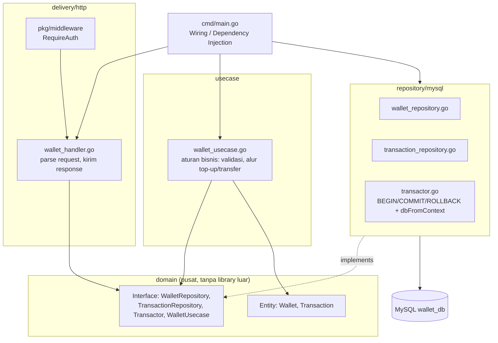

**Kenapa begini?** Usecase hanya mengenal *interface*. Ia tidak tahu apakah datanya dari MySQL, Postgres, atau data palsu untuk unit test. Mengganti database atau menulis test tidak perlu mengubah aturan bisnis.

---

## 5. Alur Fitur

### 5.1 Registrasi ✅

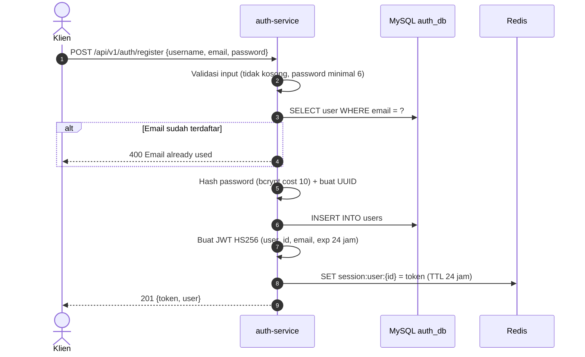

### 5.2 Login ✅

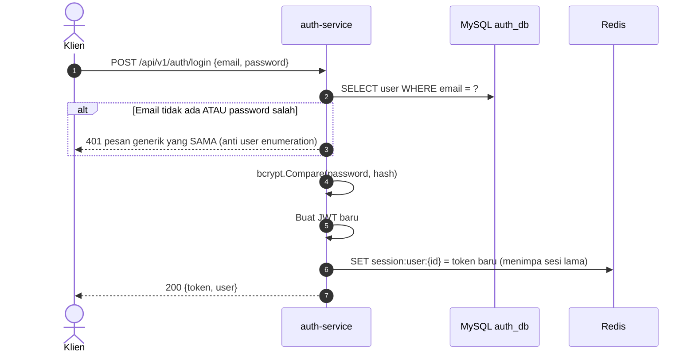

### 5.3 Auth Guard — Validasi Token di Wallet ⏳ (target)

Saat ini middleware baru memverifikasi *signature*. Targetnya juga mencocokkan token ke Redis agar token bisa dicabut (logout / login di perangkat lain).

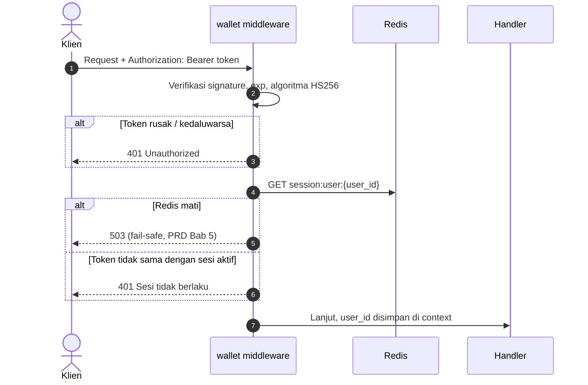

### 5.4 Cek Saldo ✅

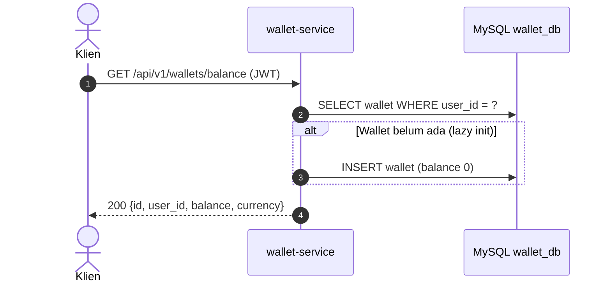

### 5.5 Top-Up Dummy ✅ (ACID terbukti lewat uji rollback)

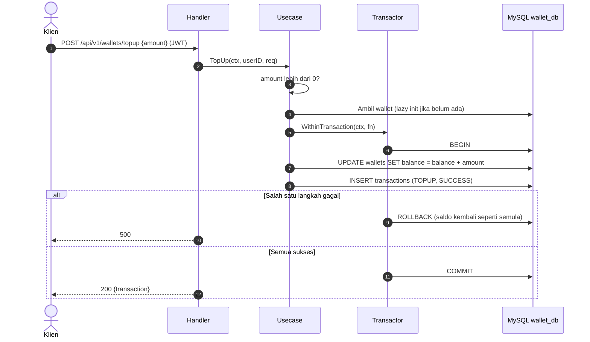

### 5.6 Transfer Antar-Akun — The Golden Flow ⏳ (Modul 3 & 4)

Fitur inti. Semua stack bekerja bersama di sini.

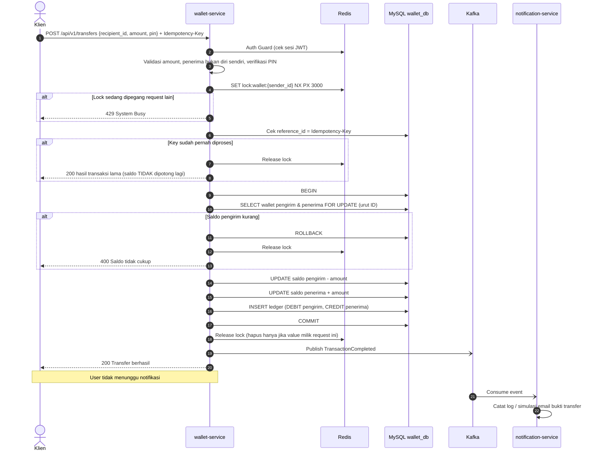

**Peran tiap stack di alur Transfer:**

| Langkah | Stack | Mengapa |
|---|---|---|
| Auth Guard | JWT + Redis | Memastikan pengirim sah dan sesinya masih aktif. |
| Lock | Redis `SET NX PX` | "Rem depan": menolak spam klik secepat mungkin sebelum menyentuh database. |
| Idempotency | MySQL unique index `reference_id` | Request yang diulang tidak memotong saldo dua kali. |
| `SELECT ... FOR UPDATE` | MySQL row lock | "Rem terakhir": walau Redis lock gagal/kedaluwarsa, database tetap mengunci baris saldo. Urutan kunci berdasarkan ID mencegah *deadlock*. |
| UPDATE + INSERT ledger | MySQL transaction via GORM | ACID: uang tidak hilang dan tidak tercipta. |
| Publish event | Kafka | Pekerjaan lambat (notifikasi) dipindah ke latar belakang. |
| Consume | notification-service | Bisa mati/lambat tanpa mengganggu transfer. |

### 5.7 Riwayat Mutasi 🟡

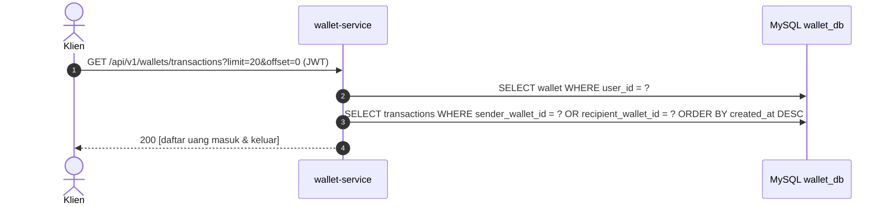

---

## 6. Model Data

### 6.1 Kondisi Saat Ini

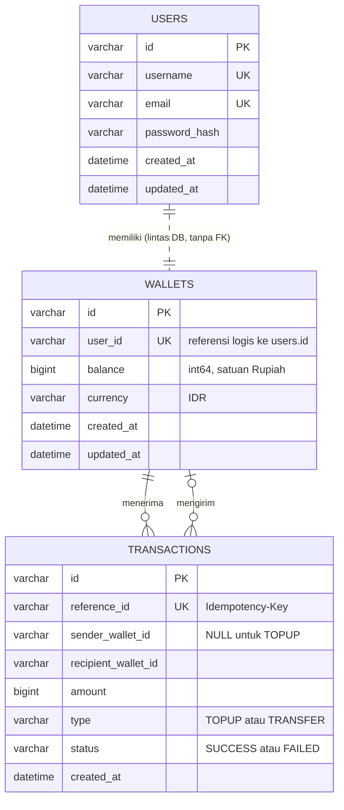

- `users` ada di **auth_db**, sedangkan `wallets` dan `transactions` ada di **wallet_db**. Relasi `users → wallets` hanya relasi *logis* (tanpa foreign key) karena beda database.
- Saldo memakai `bigint`/`int64`, bukan float, agar tidak ada selisih pembulatan.

### 6.2 Usulan untuk Fitur Transfer (R12) ⏳

PRD Bab 4 meminta catatan **debit/kredit per wallet** dengan status `pending/success/failed`. Usulannya: tabel `transactions` tetap menjadi "header" transfer, ditambah tabel `ledger_entries` (*double-entry bookkeeping*).

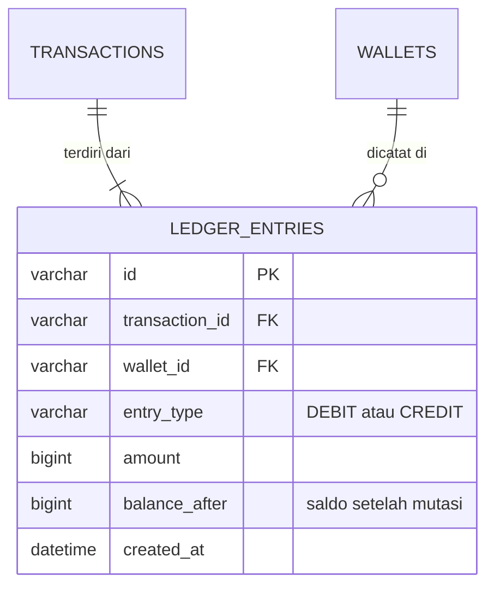

Contoh transfer 50.000 dari A ke B → 1 baris `transactions` + 2 baris `ledger_entries` (DEBIT A 50.000, CREDIT B 50.000). Total debit selalu = total kredit, jadi neraca bisa diaudit kapan saja.

---

## 7. Kunci Redis & Event Kafka

### Redis Keys

| Key | Isi | TTL | Ditulis oleh | Dibaca oleh |
|---|---|---|---|---|
| `session:user:{user_id}` | JWT aktif | 24 jam | auth-service (register/login) | wallet middleware |
| `lock:wallet:{wallet_id}` | nilai acak unik per request | 3 detik | wallet-service | wallet-service |

> Lock dilepas dengan "hapus hanya jika nilainya milik saya" (skrip Lua di Redis) agar request A tidak menghapus lock milik request B ketika lock A sudah kedaluwarsa.

### Event Kafka (usulan)

- **Topic:** `transaction.completed`
- **Producer:** wallet-service (setelah `COMMIT`)
- **Consumer group:** `notification-service`
- **Payload:**
```json
{
  "event": "TransactionCompleted",
  "transaction_id": "tx-882910-xzy",
  "sender_id": "usr-1123-abc",
  "recipient_id": "usr-9981-pqr",
  "amount": 50000,
  "occurred_at": "2026-07-18T21:05:00Z"
}
```

---

## 8. Skenario Gagal & Jaminan Sistem

| Skenario | Mekanisme Pelindung | Hasil yang Dijamin | Metrik PRD |
|---|---|---|---|
| User spam klik "Transfer" 100× | Redis lock + `SELECT ... FOR UPDATE` | Diproses satu per satu, sisanya `429`, saldo tidak minus | Zero Double-Spending |
| Koneksi labil, klien retry dengan key sama | Unique `reference_id` (Idempotency-Key) | Dapat hasil transaksi lama, saldo tidak terpotong 2× | Zero Double-Spending |
| Service crash di tengah transfer | MySQL transaction | Rollback otomatis, uang tidak hilang | ACID Compliance |
| Insert ledger gagal setelah update saldo | `Transactor` (satu `tx`) | Update saldo ikut dibatalkan (**sudah diuji ✅**) | ACID Compliance |
| Redis mati | Fail-safe | Transfer ditolak `503`, lebih baik menolak daripada salah | Zero Double-Spending |
| Kafka lambat / mati | Publish setelah commit, notifikasi asinkron | API tetap cepat. ⚠️ Risiko event hilang → catatan *Outbox Pattern* di Bab 10 | Asynchronous Speed |
| Saldo tidak cukup | Pengecekan di dalam transaksi (setelah row lock) | `400`, tidak ada perubahan data | ACID Compliance |
| Token dicuri lalu user login ulang | Sesi Redis ditimpa token baru | Token lama ditolak (setelah R11) | Security |

---

## 9. Roadmap Pengerjaan

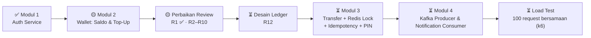

---

## 10. Keputusan Desain yang Masih Terbuka

| Topik | Pilihan | Usulan Mentor |
|---|---|---|
| **API Gateway** (PRD Bab 3 langkah 2) | (a) Validasi JWT di middleware tiap service · (b) Service gateway sendiri | (b) Gateway kecil dengan `chi` + `httputil.ReverseProxy` (standard library, tanpa dependency baru). Satu pintu masuk, validasi token terpusat. Latihan microservices yang bagus. |
| **Lokasi PIN** | (a) `pin_hash` di `users` (auth_db), wallet bertanya ke auth · (b) `pin_hash` di `wallets` (wallet_db) | (b) lebih sederhana: verifikasi PIN tidak perlu panggilan antar-service di jalur transfer. |
| **Model ledger** (R12) | (a) Tetap 1 baris per transfer · (b) Header `transactions` + `ledger_entries` | (b) sesuai PRD Bab 4 (debit/kredit per user) dan standar akuntansi. |
| **Keandalan event Kafka** | (a) Publish langsung setelah commit · (b) *Outbox Pattern* | (a) dulu sesuai PRD. Catat (b) sebagai pengembangan: event ditulis ke tabel `outbox` di transaksi yang sama, lalu dikirim ke Kafka oleh worker, sehingga event tidak pernah hilang. |
| **Wallet dibuat kapan** (R9) | (a) Lazy init saat `GET balance` · (b) Saat event `UserRegistered` dari auth | (b) setelah Kafka siap; sementara itu (a) diperbaiki agar aman dari race. |
